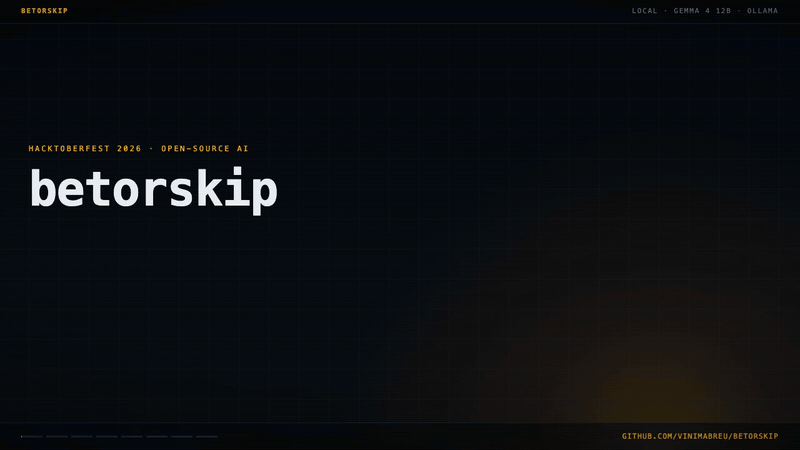

# betorskip

Paste a bet slip, or point at a screenshot of one, and get one word back: **BET**, **SKIP** or **CHECK**. A model on your own machine reads the slip. Code checks every number it read against the slip and against the slip's own arithmetic, then applies your bankroll rules.

It never says a bet will win. It reads the slip right and holds you to the rules you wrote down.



```
$ betorskip examples/slips/thin-market.txt --rules examples/rules.toml
SKIP · the house keeps 14.4% on this market (your max 8%)
Redcliff Rangers v Stonebridge · Match Result
bet      single · Redcliff Rangers @ 1.72 · stake £10.00 · returns £17.20
market   1.72 / 3.20 / 4.00 · house margin 14.4% · fair odds 1.97 (50.8%)
```

People who bet seriously write their rules down: never more than a small share of the bankroll on one bet, no six-leg accumulators, no market where the house keeps too much. The rules are easy. Applying them to every slip, at the moment of placing it, is the part that fails, and the numbers are where it fails quietly: odds of 17.47 read as 1747, a 14% margin that looks like any other price, a stake that was 12% of the bankroll.

## What it does

1. **Reads.** The slip goes to Gemma 4 (12B) through Ollama on `127.0.0.1`. The model returns each fact with the exact words it came from, and the odds exactly as printed: `2.10`, `2,10`, `5/4` or `+120`. Code turns them into decimal odds; nothing the model computes is used.
2. **Checks.** Code keeps a fact only when:
   - its quote is really on the slip;
   - its number is really in its quote, and the right label sits next to it (`£21.00` only counts as the return if "returns" or "payout" is right there);
   - odds are in their quote as printed, and are not an amount of money (`10.00` that only appears as `£10.00` is the stake, not a price);
   - the slip agrees with itself: stake times odds is the return it prints (or the profit, for "to win"), the legs multiply to the total odds, and a "6-Fold" has six legs;
   - market prices add up to between 100% and 140% of a book. That refuses a partial market or a stray number; it can't catch one price read wrong.

   Anything that fails is reported as unread, never guessed.
3. **Scans.** Plain keyword scans run on the slip itself. If it says `67'`, "in-play" or "free bet" and the model said nothing of the kind, the verdict asks you to look instead of trusting the silence.
4. **Decides.** Your rules, in a TOML file, turn the checked facts into a verdict:
   - **SKIP** names the rule the bet breaks.
   - **CHECK** means a number a rule needs could not be confirmed, or the slip disagrees with itself, so you look before placing anything. The margin rule is the exception: it only applies when a whole market is on the slip, and without one the verdict is decided by the other rules.
   - **BET** means no rule is broken. It says what share of your bankroll the stake is and how often the bet has to win to break even, and, when the whole market is on the page, what the house keeps and the market's fair odds for your pick.

## Screenshots: text you can check

Most people look at a slip on a phone, so screenshots matter. There are two ways to read one: Gemma 4 reads the image itself, or [Tesseract](https://github.com/tesseract-ocr/tesseract) turns it into text and Gemma reads the text. I rendered the twelve made-up slips as app-style screenshots, in four styles and two resolutions, and measured both.

Reading the pixels is often right, and it can't be checked. On a low-resolution screenshot of a slip with a £4.00 stake and £36.00 returns, Gemma read £40.00 and £360.00. Even the slip's arithmetic agrees (40 × 9 = 360), so nothing inside the reading says it is wrong. It also counted the market listing under a single as a second selection, and gave a parlay a $84.00 return that is not on the slip.

So a screenshot goes through Tesseract first, and Gemma reads Tesseract's text. Every quote is then checked against text the model did not write. Tesseract fails too, and these are the failures the measurement found:

- **Its default layout analysis reads a slip as two columns:** every label first, then every amount, so "Stake" ends up far from "£10.00". `--psm 4` (one column, line by line) fixed it: on the clean screenshots, verdicts went from 19 to 24 of 24.
- **It loses the small decimal point:** "Total odds 1747". The slip's own arithmetic puts it back, because £5.00 at 17.47 is the £87.33 it prints, give or take the rounding.
- **It misreads digits:** on one six-fold, 1.62 came out as 1.82, 1.80 as 4.80 and 1.30 as 4.30. The legs then multiply to 173.08, not the 17.47 total, and the slip is flagged.
- **It drops the minus of American odds and reads the plus as #:** "-110" came out as "“110" and was read as 110, which as decimal odds is "above your max". A price printed as a bare 110 is now a problem on the slip, and a rule that rests on disputed odds can't SKIP.
- **It turns "returns" into "retums" and "tums",** so "potential" counts as the label too.
- **When a line comes out garbled, Gemma tidies it.** From "Redcliff Rangers 472" and a Stonebridge with no price, it quoted "Redcliff Rangers 1.72 Draw 3.20 Stonebridge 4.72". That line is not in the text, so the quote check refuses it.

How the verdicts came out, Tesseract then Gemma, against the verdict each made-up slip was written for:

| screenshots | how they were used | right | CHECK | wrong |
|---|---|---|---|---|
| 24 clean, 2x | to choose `--psm 4` | 24 | 0 | 0 |
| 24 low-resolution JPEG | the fixes above were made on these | 21 | 3 | 0 |
| 24 in two new styles, low-resolution JPEG | measured once | 10 | 13 | 1 SKIP that should have been BET |
| 24 in the new styles, 2x PNG | measured once; nothing was tuned on it, and the final code gives the same 24 verdicts | 17 | 6 | 1 BET that should have been SKIP |

"Wrong" is a BET or a SKIP where the slip called for something else; CHECK is the tool sending the slip back to you. The wrong SKIP came from a market whose three prices were all misread the same way. The odds and stake rules already stood down when the slip disputed them (that came from the batch above); after this one, the margin rule does too. The wrong BET is the number to keep in mind: Tesseract dropped the "Draw 3.20" line of a market where the house keeps 14.4%, the margin rule had nothing to apply to, and the slip passed. A single whose market was only partly read now says "house margin unknown" instead of staying quiet, but the verdict is still BET. And in that last batch Tesseract read a whole market on only 2 of the 24 screenshots, neither of them a BET: none of the seven BETs had the margin rule applied, and five of them were right only because the made-up markets sit under 8%.

The last row is the closest to a phone screenshot. On the new-style small JPEGs most slips came back CHECK, which is the tool noticing text it can't trust, not reading it right: send the screenshot as the phone saved it, not a shrunk copy. Gemma reading the pixels got 3 of 110 key numbers wrong on each 2x batch and 19 and 25 of 110 on the two small-JPEG batches, and on all of them it added things that are not on the slip. A screenshot takes about 7 seconds either way.

If Tesseract is not installed, the model reads the image, the reading is marked unchecked, and no rule gets to decide on it: the verdict is CHECK.

## Tested

Each of the twelve made-up slips, one for each rule or odds format, went through Gemma 4 12B three times: 36 of 36 runs gave the expected verdict, with the same first line every time, at a median of 5.5 seconds a slip on my laptop. Twelve slips is a small set: it says the reading is stable on clean text, not that it is right on every slip you will meet. The screenshot measurements above are the harder half.

The 134 tests replay recorded answers, for the twelve slips and for four low-resolution screenshots, so they run without a model or a network. Each check has the failure that motivated it as a test: the $84.00 the model worked out on its own, the lost decimal point, the misread legs, the lost minus sign, `retums`, the single quoted twice, a market misread three times the same way.

## Install

You need Python 3.11+, [Ollama](https://ollama.com) with Gemma 4, and Tesseract for screenshots.

```bash
ollama pull gemma4:12b
brew install tesseract          # or apt install tesseract-ocr
pip install git+https://github.com/vinimabreu/betorskip
```

No Python dependencies. The model client refuses any Ollama host that is not loopback unless you pass `--allow-remote-model`, and it ignores proxy settings, so a slip never leaves your machine by accident.

## Use

```bash
betorskip slip.txt                    # a slip saved as text
pbpaste | betorskip                   # or straight from the clipboard
betorskip                             # with nothing piped in, it reads the clipboard itself (macOS)
betorskip screenshot.png              # Tesseract, then the model
betorskip slip.txt --bankroll 380     # today's bankroll instead of the one in your rules
betorskip slip.txt --prob 52%         # your own chance: adds expected value and a Kelly stake
betorskip slip.txt --explain          # every fact, the words it came from, and whether they held up
betorskip slip.txt --json             # for a script
```

`--explain` is how you see what it saw (trimmed). On this parlay, Gemma worked out a $84.00 return on its own and quoted it; the slip only prints "To Win $64.00", so the $84.00 is dropped and the arithmetic runs on the $64.00:

```
$ betorskip examples/slips/us-parlay.txt --rules examples/rules.toml --explain
BET · stake 4.0% of your bankroll · break-even 23.8%
bet      PARLAY (2 LEGS) · odds 4.20 · stake $20.00 · to win $64.00
legs     Cobbleston Pioneers @ -110 · Austin Comets @ +120
note     ignored returns 84: quote is not on the slip

ok selection 1   -110                  "Cobbleston Pioneers · Moneyline · -110"
ok selection 2   +120                  "Austin Comets · Spread +4.5 · +120"
ok stake         20                    "$20.00"
NO returns       84                    "$84.00"  <- quote is not on the slip
ok to_win        64                    "$64.00"
ok total_odds    +320                  "Parlay odds +320"
```

With `--prob`, your own estimate becomes expected value and a Kelly stake. The probability is yours; the tool only does the arithmetic:

```
$ betorskip examples/slips/single-home-win.txt --rules examples/rules.toml --prob 52%
BET · stake 2.0% of your bankroll · break-even 47.6%
Northgate Rovers v Kingsport City · Match Result
bet      single · Northgate Rovers @ 2.10 · stake £10.00 · returns £21.00
market   2.10 / 3.40 / 3.50 · house margin 5.6% · fair odds 2.22 (45.1%)
note     at your 52% the bet is worth +9.2% of the stake; Kelly says 8.4% of bankroll, 0.25 Kelly is £10.45
```

## Your rules

Copy [`examples/rules.toml`](examples/rules.toml) to `~/.config/betorskip/rules.toml` and change the numbers. The example is a made-up bettor with a 500 bankroll:

| setting | example | what it does |
|---|---|---|
| `bankroll`, `max_stake_pct` | 500, 5 | a stake above 5% of the bankroll is a wall; `--bankroll` overrides it for today |
| `min_odds`, `max_odds` | 1.30, 6.0 | odds outside this range are a wall |
| `max_legs` | 3 | more selections than this on one slip is a wall |
| `max_margin_pct` | 8 | a market where the house keeps more than 8% is a wall (only when the whole market is on the page) |
| `never` | correct score, first goalscorer, bet builder | markets you don't bet; the words on the slip are a wall |
| `live_is_wall` | false | an in-play bet is a note; set true if you don't bet live |
| `max_rollover` | 5 | a bonus that must be wagered more than 5 times is a wall |
| `min_edge_pct`, `kelly_fraction` | 2, 0.25 | with `--prob`: an expected value under +2% is a wall, and a quarter of the Kelly stake is suggested, never above your max stake |

An unknown setting, a setting given twice, a wrong type, a negative or non-finite number, or an empty word in `never` is refused, so a typo can't silently turn a rule off.

## What it does not do

- It does not predict anything. Break-even, house margin and fair odds are arithmetic on the prices; expected value and Kelly use the probability you give it, and are only as good as that number.
- It does not read any bookmaker for you. You paste or capture the slip; nothing here logs in, scrapes or places a bet.
- It can't tell a misread price from a real one when the slip has nothing to check it against. A price you did not pick, read wrong, changes the margin; the 100% to 140% bound catches a stray number, not that.
- The flag checks are lists of words, not proof. They stop a quote that talks about something else; they can't prove a quote means what the model says.

## Development

```bash
pip install -e '.[test]'
pytest                          # no model, no network: recorded readings are replayed
python examples/record.py       # re-record the example readings after a prompt change
```

The slips, teams and players in `examples/` are made up.

## License

MIT
